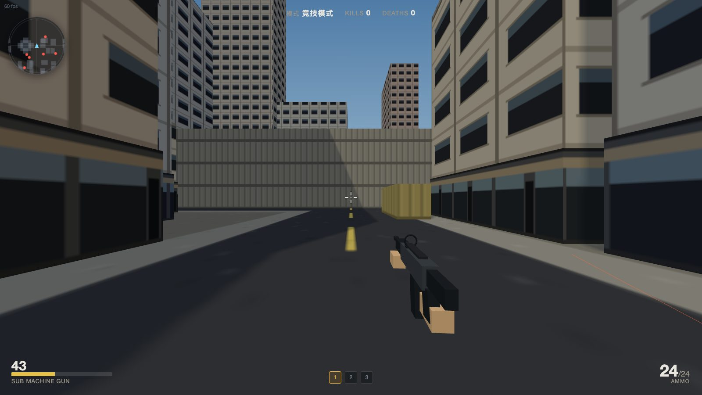

# VANTAGE

浏览器第一人称射击游戏。纯静态、无构建、可离线：下载 `index.html` 双击就能玩。

- 200 × 200 米程序化街区城市，三张预设（市中心 / 矮城区 / 高楼区）
- 100 个人机，无尽模式；冲锋枪 / 狙击 / 手枪 / 武士刀 / 钩索枪
- 局域网单挑（`server.py`）与房间码联机（WebRTC）
- 整包只有 MIT / CC0 素材，没有任何没有授权的模型

## 直接玩

- 下载本仓库的 `index.html`，双击用浏览器打开（不需要服务器，也不需要联网）。
- 或者直接在浏览器里玩：<https://bigbraindevbros.github.io/VANTAGE/>（GitHub Pages，和仓库里的 `index.html` 是同一份文件）。

## 操作

| 键 | 作用 |
|---|---|
| 鼠标左键 | 开火 / 挥刀 |
| 1 / Q / 2 / 3 / 4 | 冲锋枪 / 狙击 / 手枪 / 近战 / 钩索枪 |
| E | 开镜（狙击、手枪） |
| C | 第一 / 第三人称 |
| 右 Shift | 训练辅助面板（吸附、透视、穿墙… 只改本机） |
| R / Y | 换弹 / 检视武器 |
| Shift / Space | 蹲下 / 跳（战术模式不能跳） |
| M / ESC | 静音 / 设置 |

首页可以选图；「开始游戏」是无尽单机，「开房间 / 加入」是联机单挑或合作。

## 玩法

- **地图**：4 × 4 个街区、14 米街道，程序化生成；有围合院子、塔楼、货场、广场。
  外挂消防梯可以上屋顶，人机也会顺着梯子爬上来。
- **人机**：1 米导航网格 + 流场（BFS），会绕街区、钻巷子、从院子另一头包过来；
  玩家站上屋顶时目标改成那栋楼的梯底，走到就爬上来。
- **碰撞 / 射线 / 命中**：全部走 `addBox` 生成的轴对齐盒子，8 米格子哈希加速。
- **联机**：单挑先到 N 杀；合作模式两个人一起打人机。局域网用 `server.py`，
  不在同一个 wifi 就用房间码（PeerJS 公共云只交换 SDP）。客户端权威，没有防作弊。

## 素材与授权

整包只有 MIT / CC0，可以自由分发：

| 素材 | 授权 |
|---|---|
| Three.js r170 | MIT |
| PeerJS 1.5.4 | MIT |
| Kenney 场景道具（树 / 桶 / 花坛 / 路障） | CC0 1.0 |
| warfork-free-soundpacks 音效 | CC0 1.0 |
| 武士刀 katana.glb | CC0 1.0（3dassets.dev） |
| 地图、贴图、UI、AI、联机、方块模型、一半音效 | 本项目自写 / 程序生成 |

详见 [CREDITS.md](CREDITS.md)。武器数值参考了 Krunker wiki 和 DustIII 的表，代码是自写的。

## 关于这个仓库

`index.html` 是单文件构建产物：渲染引擎、游戏逻辑、模型、音效全部内联在一个 HTML 里，
所以可以直接双击运行，也可以直接托管成静态页。源码不在这里。