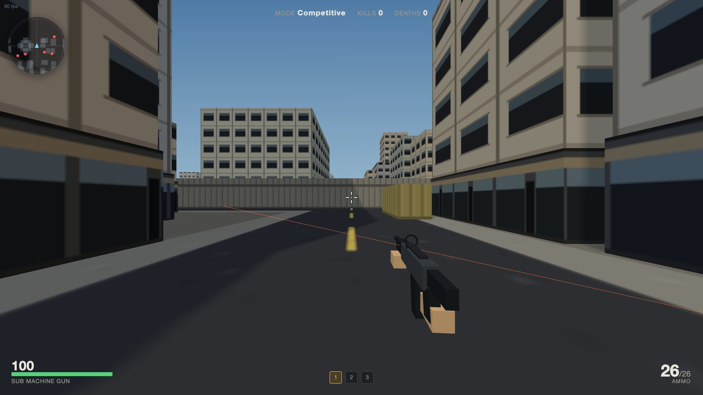

# VANTAGE

**A Single-File Browser FPS With A Procedural City**

[Play Online](https://bigbraindevbros.github.io/VANTAGE/) · [Changelog](changelog.md) · [Security Policy](security.md) · [License Notices](license) · [Credits](credits.md)

## Key Features

- A walled 3×3 / 4×4 / 5×5 arena (150 / 200 / 250 m on the default preset) inside an endless procedural city that streams in around the player
- Up to 100 bots with flow-field pathfinding; endless solo mode
- SMG, sniper, pistol, katana, grappling hook
- 1v1 duels and co-op vs bots over LAN or room codes (WebRTC)
- MIT / CC0 assets only, no unlicensed models

## Play

- **Offline:** download `index.html` and open it in a browser. That is all it takes.
- **Online:** <https://bigbraindevbros.github.io/VANTAGE/> — the same file, served by GitHub Pages.
- **Language:** English and Chinese are both available (Settings → Language).

## Controls

| Key | Action |
|---|---|
| Left mouse | Fire / melee |
| 1 / Q / 2 / 3 / 4 | SMG / sniper / pistol / melee / grappling hook |
| E | Aim down sights (sniper and pistol) |
| C | First / third person |
| Right Shift | Training aids panel (aim assist, ESP, wallbang; local only) |
| R / Y | Reload / inspect weapon |
| Shift / Space | Crouch / jump (jump is disabled in tactical mode) |
| M / Esc | Mute / settings |

Pick a map and a size on the home screen. "Start game" is endless solo; "Create / join room" is multiplayer.

## Gameplay And Engine

- **City:** a block grid with 14 m streets, generated at startup — courtyard blocks, towers, a freight yard, a plaza. You pick a 3×3, 4×4 or 5×5 walled arena on the home screen; beyond the wall the city continues and streams in around the player (visual only, no collision). Fire escapes lead to the roofs, and bots will climb them to follow you.
- **Bots:** a 1 m navigation grid plus one flow field (BFS) shared by every bot, so they path around blocks and through alleys instead of sliding along walls. When you stand on a roof, their target becomes that building's fire-escape landing.
- **Collision, raycasts, hit detection:** all against the axis-aligned boxes created by `addBox`, accelerated with an 8 m spatial hash. Bullets use a 2D DDA plus slab test against those boxes.
- **Multiplayer:** 1v1 first-to-N, or co-op against bots. Room codes use WebRTC signaling through PeerJS. LAN mode requires a separate `server.py` that is outside this distribution. Client-authoritative, no anti-cheat; play with friends.

## Tech

Three.js r170 for rendering, WebAudio for sound, PeerJS for WebRTC. Everything is bundled into a single HTML file: engine, game code, models (base64) and sounds. The city, textures, UI, AI, netcode and the block-built weapons and characters were written for this project.

## Assets And Licenses

Bundled assets and dependencies carry their own licenses. Original project work is credited below.

| Asset | License |
|---|---|
| Three.js r170 | MIT |
| PeerJS 1.5.4 | MIT |
| Kenney props (trees, barrels, planters, barriers) | CC0 1.0 |
| warfork-free-soundpacks | CC0 1.0 |
| Katana model | CC0 1.0 (3dassets.dev) |
| Maps, textures, UI, AI, netcode, block models, half the sound effects | Original |

See [Credits](credits.md) for details. Weapon numbers were tuned for this game; the code is original.

## Bugs And Feedback

Found a bug, a softlock, or something that just looks wrong? Open an issue:
<https://github.com/BigBrainDevBros/VANTAGE/issues/new?template=bug_report.md>

In the game, **Settings → Report a bug** opens that page and fills in the build info for you:
version (`?v=209`), map and size, bot count, browser, graphics settings, and the last console errors
from `window.__errs`. The same block is copied to the clipboard, so you can paste it into a comment.

Screenshots help a lot — drag them into the issue box.

## Authors

Built by **@hilbertqiu** together with an AI coding assistant.
Ideas, design direction and playtesting are human; code, tooling and documentation were written jointly.

## Development

Open `index.html` in a desktop browser for an offline smoke test. Confirm that the menu loads and that a solo match starts. Room-code multiplayer requires network access. The editable game source lives outside this distribution repository.

Run `python3 scripts/check-repository.py` to check the tracked files. Add `--fix` to restore missing final newlines and correct link casing when the tracked target is unambiguous. Run the check again to verify the result. GitHub Actions checks branch pushes and appends a bot commit only when there are safe changes and the branch still points at that push. It reports issues such as invalid commit subjects, unsafe paths, and binary links for contributors to review.

## Contributing

Commit subjects follow one shape: `type: three lowercase words`, for example `docs: add thanks section`.
The type is a short lowercase word such as `feat`, `fix`, `docs` or `ci`.
`scripts/check-repository.py` checks the tracked Markdown (code fences, heading case, link casing, trailing newlines)
and the subjects of new commits; the `Repository Compliance` workflow runs the same check on every push and
repairs safe Markdown issues when the branch has not moved.

## Thanks

Thanks to **Even** ([@AMFI-Disable](https://github.com/AMFI-Disable)), founder of BigBrainDevBros, for setting this repository up properly: the README layout and badges, the lower-case file naming, the issue and pull request templates, the license and security policy, the changelog and `.gitignore`, and the compliance workflow with `scripts/check-repository.py` that keeps links, file names and commit subjects tidy.

---

© 2026 hilbertqiu
