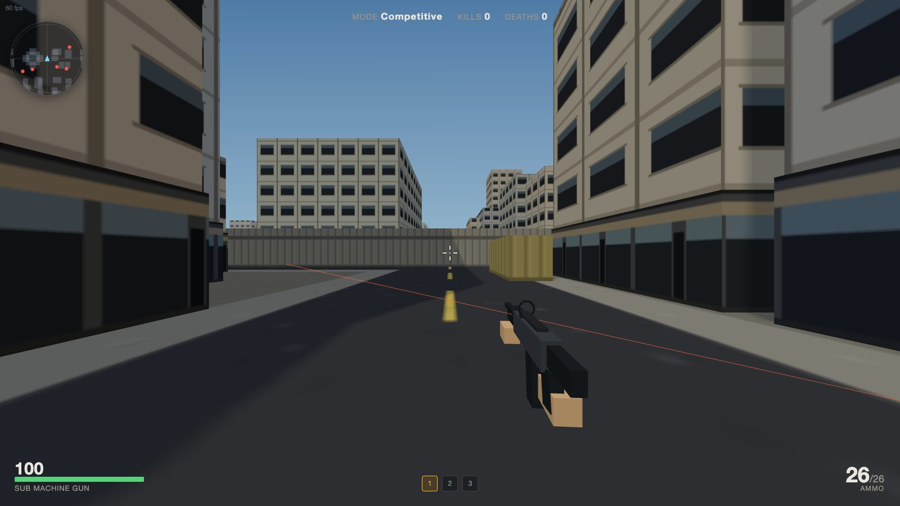

# VANTAGE

[English](readme.md) · [贡献指南](contributing.zh-cn.md)

VANTAGE 是一款单 HTML 文件的浏览器第一人称射击游戏。玩家在程序生成的城市中单人游玩、与好友对决或合作对抗电脑。

[在线游玩](https://bigbraindevbros.github.io/VANTAGE/) · [更新日志](changelog.md) · [安全策略](security.md) · [许可](license) · [素材署名](credits.md)

## 开始游戏

离线时可用桌面浏览器直接打开 `index.html`。线上版本通过 GitHub Pages 提供同一个文件。在设置的语言选项中可切换英文和中文。在首页选好地图和大小后，“开始游戏”进入无尽单人模式，“创建 / 加入房间”进入多人模式。

地图尺寸为 3×3、4×4 或 5×5 个街区；默认预设的边长分别为 150、200 和 250 米。可选中午、黄昏和夜间，夜间有路灯和亮灯的窗户。四档画质控制阴影分辨率和渲染比例。场景中有路灯、交通灯、停放的车辆、长椅、垃圾箱和消防栓，屋顶上可见水箱、空调和楼梯间。

## 操作

| 按键 | 动作 |
| --- | --- |
| 鼠标左键 | 射击或近战 |
| 1 / Q / 2 / 3 / 4 | 冲锋枪 / 狙击枪 / 手枪 / 武士刀 / 抓钩 |
| E | 瞄准（狙击枪及手枪） |
| C | 切换第一、第三人称 |
| 右 Shift | 打开仅在本地生效的训练辅助面板 |
| R / Y | 换弹 / 检视 |
| Shift / 空格 | 蹲下 / 跳跃；战术模式下无法跳跃 |
| M / Esc | 静音 / 设置 |

## 游戏与引擎

- 开局时在街区网格上生成宽 14 米的街道、庭院、高楼、货场和广场。围墙外的城市随玩家移动加载，仅作远景显示。楼梯通向屋顶，电脑对手也能沿梯追上屋顶。
- 单人模式最多有 100 个电脑对手。它们使用 1 米导航网格并共享广度优先搜索生成的流场，以绕开街区和墙体。
- 碰撞、射线和命中判定使用轴对齐包围盒和 8 米空间哈希。游戏中的射线先遍历网格，再与包围盒求交。
- 多人模式支持约定胜局数的 1v1 及合作对抗电脑。房间码通过 PeerJS 信令建立 WebRTC 连接。局域网模式需要本发行仓库以外的 `server.py`。多人游戏由客户端处理状态，适合与熟人游玩。
- Three.js r170 负责渲染，WebAudio 负责声音。引擎、游戏代码、Base64 模型与音效均打包在同一个 HTML 文件内。

## 素材、署名与许可

| 组件或素材 | 许可或来源 |
| --- | --- |
| Three.js r170、PeerJS 1.5.4 | MIT |
| Kenney 道具（树、桶、花箱、路障） | CC0 1.0 |
| warfork-free-soundpacks | CC0 1.0 |
| 武士刀模型 | 3dassets.dev，CC0 1.0 |
| 地图、纹理、界面、电脑对手、网络代码、方块模型和约半数音效 | 项目原创 |

原创游戏代码、程序化地图、画布纹理、界面、电脑对手逻辑与网络代码使用 [MIT 许可](license)。第三方组件各自保留原有许可，全文随 `index.html` 分发。详细信息见[素材署名](credits.md)。游戏内的武器数值由本项目调校。

## 问题反馈

请通过[缺陷报告](https://github.com/BigBrainDevBros/VANTAGE/issues/new?template=bug_report.md)反馈卡死、显示异常或其他问题。游戏设置中的反馈按钮会填写构建版本（地址中的 `?v=`）、地图、场地大小、电脑对手数量、浏览器、画质设置及 `window.__errs` 中的近期错误，并将同样的信息复制到剪贴板。显示问题可附上截图。

## 开发与贡献

可编辑的游戏源码另行维护；此仓库存放发行文件。离线冒烟测试时，用桌面浏览器打开 `index.html`，确认菜单加载并能开始单人对局。房间码联机需要网络。

运行 `python3 scripts/check-repository.py` 检查已跟踪文件。加上 `--fix` 可补全文件末尾换行并修复目标唯一的链接大小写，随后应再次运行普通检查确认结果。提交标题使用小写类型和三个小写单词，例如 `docs: add thanks section`。推送到分支后，Repository Compliance 工作流会检查 Markdown、文件路径和新增提交；只有在分支未移动且可安全修复时才追加自动提交。

## 作者与致谢

**@hilbertqiu** 与 AI 编程助手共同完成本项目。创意、设计方向与试玩来自作者，代码、工具和文档由双方协作完成。

感谢 BigBrainDevBros 创始人 **Even**（[@AMFI-Disable](https://github.com/AMFI-Disable)）协助整理仓库的说明与徽章、小写文件名、问题和拉取请求模板、许可、安全策略、更新日志、忽略规则，以及检查链接、文件名和提交标题的自动化流程。

© 2026 hilbertqiu
